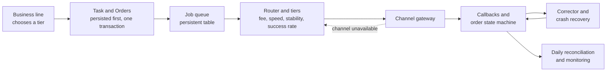

# inhouse-payment-platform

Keep the hard parts in the platform, keep it simple for business lines.

A synthetic, clean-room rebuild of a company-internal payment platform: channels onboarded by configuration, service tiers instead of providers, routing and failover, callbacks, crash recovery, daily reconciliation and monitoring. All channels, amounts and users are generated.

## Why this platform

In a lending business, every business line needs to collect and pay money, and each one used to integrate payment providers on its own. Every new provider meant weeks of contracts and integration, fees nobody compared, outages whenever a provider ran maintenance, and finance staff reconciling by hand every morning when the books still did not balance.

An in-house payment platform takes that pain away from the business lines. They onboard once by configuration, choose a service tier instead of a provider, and the platform handles routing, failover, callbacks, recovery, and daily reconciliation. Our motto was *"make payments simple and safe"*: the complexity stays on the platform's side.

## Why me

From 2016 to 2018 I was the product and architecture lead for exactly this kind of platform at a Beijing consumer-finance group. It was the department closest to the company's money. A bug there was a real loss.

- I rebuilt the real-time debit system over six months without pausing production. Average processing time fell 97%, and 91% of requests completed within 10 seconds across three peak billing months.
- Debit success for a key lending program rose from 40% to 97% after we made failure reasons visible every day.
- I packaged 10+ providers into four service tiers by fee rate, speed, stability, and success rate, and presented the platform at the company's 2017 product launch.
- I did it with a team that had been rated lowest the year before and was close to being disbanded.

This repository rebuilds the core ideas on synthetic data. No code or documents from that employer are used. It was built by AI agents under the same discipline I used with that team: small scoped tasks, tests first, independent review, and my sign-off on the exact commit.

## Run it

Prerequisite: JDK 21 (the Maven wrapper is included).

```
./mvnw -q spring-boot:run -Dspring-boot.run.arguments=demo
# or
make demo
```

The demo prints eight labelled scenarios and ends with `DEMO RESULT: ALL SCENARIOS PASSED` (exit code 0) or `DEMO RESULT: FAILED <scenario>` (exit code 1). It uses an in-process synthetic channel simulator and a fresh H2 file database in a temp directory. Tests: `./mvnw test`.

## What the demo proves

| # | Scenario | What is guaranteed | Covered by |
|---|---|---|---|
| 1 | Onboard a channel by YAML only, debit with tier FASTEST, callback, daily reconciliation | A new channel is one YAML block and no code change; the business line picks a tier, not a provider; the books balance | `DemoRunnerTest`, `ChannelRegistryTest`, `ExtraChannelTest`, `RouterTest`, `ReconciliationTest` |
| 2 | Duplicate submit | The same business request id debits once | `DemoRunnerTest`, `IdempotencyTest` |
| 3 | Callbacks out of order or duplicated | Only legal state transitions; terminal states are immutable | `DemoRunnerTest`, `OrderStateMachineTest`, `CallbackServiceTest` |
| 4 | Channel down | Automatic failover to the next channel of the tier; the switch is logged; a circuit breaker stops hammering a dead channel | `DemoRunnerTest`, `ChannelSwitchServiceTest`, `CircuitBreakerRegistryTest`, `SwitchLogPersistenceTest` |
| 5 | Partial success | The task stops as `NOT_FINALIZED` with a reason and is never reported as success | `DemoRunnerTest`, `SubmitAndSplitTest`, `TaskRefreshTest` |
| 6 | Process killed mid-flight | After restart, recovery asks the channel first and never debits twice | `DemoRunnerTest`, `CrashRecoveryTest`, `RecoveryServiceTest`, `PersistBeforeExecuteTest` |
| 7 | Channel statement disagrees | Reconciliation lists `LONG`, `SHORT`, `AMOUNT_MISMATCH`, `STATUS_MISMATCH` | `DemoRunnerTest`, `ReconciliationTest` |
| 8 | Monitoring | Per-channel success rate, p50/p95 latency and failure reasons as JSON | `DemoRunnerTest`, `MonitoringTest` |

The process kill in scenario 6 is simulated: an exception inside the channel gateway ends the first application context, and a second context starts on the same database file. Everything the second context knows comes from what was persisted.

## Architecture sketch



## How this was built

The process is the product of this repository as much as the code.

- The Owner sets goals and acceptance criteria.
- The architect agent writes the design, one card per feature (scope, allowed files, budget) and the red tests first.
- The executor agent (Codex) implements inside the card's scope. It may not edit the tests.
- The architect reviews the result against the design, then CI and a gate decision follow.
- The Owner signs the exact commit before publication.

The full method is described in the [multi-agent-delivery-playbook](https://github.com/Derrickxxm/multi-agent-delivery-playbook).

Where to look:

- `docs/DESIGN.md`: the design the cards implement.
- `docs/cards/`: one card per feature, with allowed paths and budget (index in `docs/cards/README.md`).
- `docs/reviews/`: the architect's review record per card, including gate decisions.
- The commit history: commits carry a `Role: architect` or `Role: executor` trailer. Cards and red tests come before implementations.

Honest note: several bugs were in the architect's own tests, and they were found only when executor builds ran against them (a test configuration leaking into other Spring contexts, tests that violated a rule the architect had written, a clock that ignored a rate limit). They were fixed in the open as separate architect commits and are listed in `docs/reviews/`.

Test count: 181 Java tests (`./mvnw test`) and 8 Python tests for the public scan script (`pytest tests_py`), all run in CI.

## License

MIT, see `LICENSE`.
